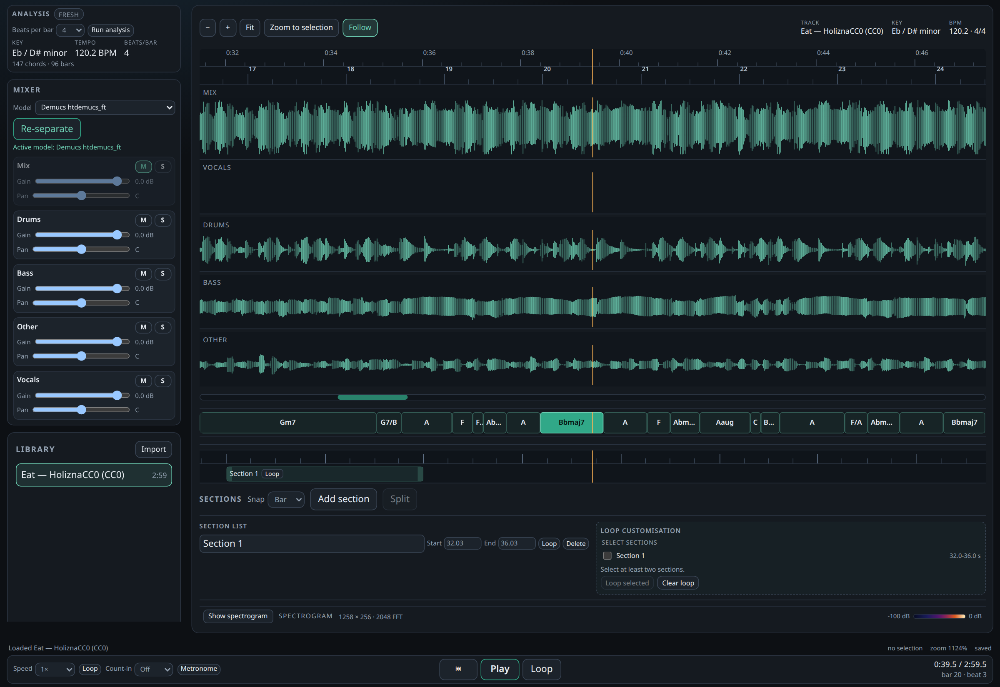

# PALM: Practice Any Local Music

## Abstract

PALM is a free practice room that runs on your own computer, for music you
already own. It can split a recording into singing, drums, bass and everything
else, show the chords and the beat, slow the music down without making it sound
higher or lower, and loop the sections you want to practise. Everything stays on
your computer: no account, no upload and no internet connection.

**Early version.** This is a 0.1.0-dev build with limited testing and quality
control. Expect setup failures, incomplete platform coverage and model or
licence edge cases. Keep your own backup of any project you care about.

## Portable Linux release

The repository publishes a portable Linux x86_64 tar with `SHA256SUMS` and
release notes. It bundles the app, web UI, analysis workers, setup code,
launcher and a pinned Python/uv runtime. It does **not** bundle model weights,
Sonic Visualiser/Piper, Vamp plugins, PyTorch environments or ffmpeg.

The launcher is `bin/palm`; it starts the server and auto-opens the browser.

The first launch opens a setup wizard. It checks the machine, offers optional
Sonic Visualiser and Vamp downloads with their licences, creates a CPU or CUDA
environment, and lists the three separation models as equal choices with no
default. Setup needs network access for the pieces you choose, and `ffmpeg` and
`ffprobe` must already be installed. Setup can be skipped; playback, importing,
chords, sections and the spectrogram then work without the optional pieces. See
[docs/portable.md](docs/portable.md) and the clean-room record in
[packaging/VERIFICATION.md](packaging/VERIFICATION.md).

## Purpose and gaps

The project exists to practise a song against its own harmony, tempo and form
without uploading audio to a service. Practice tools usually split the job:
cloud services such as Moises [1] produce stems and practice aids, visualisers
such as Sonic Visualiser [2] expose analysis, and separation GUIs such as UVR
[3] produce stems without a practice transport. This project keeps the steps
local and attaches the analysis to the same bar grid that drives practice.

## Features

- **Import and project store.** `basseparate serve` probes a local audio or
  video file with ffprobe, decodes one PCM copy at the project rate, writes
  waveform peaks and stores a versioned project document.
- **Model-selectable separation.** The setup wizard and mixer offer three
  equal, hash-verified choices: `htdemucs_ft` (four stems), SCNet XL IHF (four
  stems) or BS-RoFormer-SW (six stems, adding guitar and piano). None is
  preselected or installed by default. Every model has its own
  content-addressed cache, progress, cancellation and per-stem waveform peaks
  [4][14][15][16].
- **Chord, key and beat analysis.** The **Analyse** control runs Chordino, the
  QM Key Detector and the QM Bar and Beat Tracker through the Piper host, then
  persists chords, key and the bar/beat grid [5][6][7][8].
- **Practice transport.** Play, pause, seek, 0.25-2x speed with preserved
  pitch, metronome and a count-in that is audible even with the metronome off.
- **Sections and loops.** Bar-snapped sections, draggable ranges, overlap
  handling and a chain loop from the first selected section to the last.
- **Waveforms and spectrogram.** A mix waveform, synced stem lanes, a chord
  ribbon and a spectrogram labelled at every semitone from C1 to C8.
- **Pinned installer.** `make install-tools` checks the toolchain, downloads
  Sonic Visualiser and the Vamp Plugin Pack from their official releases with
  SHA-256 verification, and fetches the Demucs weights only after consent.
- **Offline verification.** `make gate` runs lint, typing, fixtures, Python and
  web tests, the production build and two browser specs.

## Not for / limitations

- **Limited testing and quality control.** This is an early 0.1.0-dev build.
  The portable asset was smoke-tested in a minimal Linux container fallback,
  not across distributions; the Ubuntu 22.04 container path is CI-only and not
  independently evidenced here.
- Linux x86_64 is the tested platform; Windows and macOS are not packaged.
- The server is loopback-only. There are no accounts, cloud processing or
  multi-user features.
- Pitch shifting is not exposed; speed changes preserve pitch.
- The release does not contain the Demucs weights, the Vamp plugin pack or the
  Sonic Visualiser/Piper binaries. The setup wizard needs one network session
  for whichever pieces you install. The Demucs weights have no separate licence
  and are used for research.
- Chord and key results depend on the plugins. Relative major/minor ambiguity
  and the beatless-material tempo estimate are documented plugin behaviour.
- GPU inference is supported, but no GPU separation timing or final listening
  pass is part of this release's evidence.
- No model is bundled or preferred. Demucs is 321 MiB, SCNet XL IHF 204 MiB
  and BS-RoFormer-SW 667 MiB; each needs an explicit choice and consent in the
  setup wizard. The BS-RoFormer-SW mirror has no declared upstream licence, so
  it is used privately and is not redistributed.
- On CPU, the models differ widely in speed: on the 8 s fixture, Demucs took
  19.2 s, SCNet 58.2 s and BS-RoFormer-SW 67.4 s, about 2.4x, 7.3x and 8.4x
  realtime (roughly 12, 36 and 41 minutes for a five-minute song). Choose
  according to the trade-off; nothing is selected for you.

## Screenshot



Practice view after analysis and separation of “Eat” by HoliznaCC0, a CC0
recording from the OpenGameArt Funk Collection [13]. The screenshot shows the
current PALM layout with the model dropdown and four Demucs stems; installing
BS-RoFormer-SW adds guitar and piano lanes. The spectrogram is collapsed in the
capture. No audio file is included in this repository.

## Reproduction environment

| Item | Value |
| --- | --- |
| Operating system | Linux x86_64, tested on Nobara with the Fedora 44 kernel |
| Python | 3.11.15, managed by uv 0.12.0 |
| Node.js / pnpm | 22.22.2 / 12.15.0 |
| FFmpeg / FFprobe | 8.1.3 |
| Browser | Firefox (primary) and Chromium, driven by Playwright 1.63.0 |
| Python packages | FastAPI 0.142.0, uvicorn 0.54.0, pydantic 2.13.5, numpy 2.4.6 |
| Web packages | React 19.3.0, Vite 8.3.1, TypeScript 5.9.3, Vitest 5.0.2 |
| Separation environment | demucs 4.1.0, torch 2.9.1 |
| Optional model environment | Python 3.11.15, msst 0.1.0, torch 2.9.1 (`analysis-models/uv.lock`) |
| GPU present during development | NVIDIA RTX 4080 with CUDA; the stem timing below is CPU |
| Input data | Synthetic fixtures generated by `make fixtures`; no third-party audio |

## Install and run

The commands assume a fresh clone of this repository. The Python package and
CLI keep the historical name `basseparate`; PALM is the product name, and the
unchanged identifiers keep existing projects and data directories working.

1. Install the prerequisites: Python 3.11, Node.js 22, pnpm, uv and FFmpeg.
   `make install-tools` prints distribution package commands for anything
   missing.
2. Create the environments:

   ```sh
   uv sync
   pnpm install
   (cd analysis && uv sync)
   (cd analysis-models && uv sync)   # only for SCNet / BS-RoFormer-SW
   ```

3. Prepare fixtures and the external tools:

   ```sh
   make bootstrap
   make install-tools
   # or, after reading the weights notice:
   make install-tools ACCEPT_MODEL_TERMS=1
   make build-web
   ```

   `make install-tools` checks the OS, Python, Node, uv, pnpm and FFmpeg,
   downloads Sonic Visualiser 5.2.1 and the Vamp Plugin Pack 2.0 from their
   official release pages, verifies every SHA-256, and runs `make doctor`. The
   four `htdemucs_ft` checkpoints and preset are fetched only after the explicit
   consent flag or an `accept` answer. Nothing third-party is written into git.
   The optional separation models are installed separately and only on request:

   ```sh
   make models-list
   make models-install ID=scnet-xl-ihf     # 204 MiB
   make models-install ID=bs-roformer-sw   # 667 MiB, six stems
   ```

   The URLs, sizes, SHA-256 values and licences are in
   `THIRD_PARTY_DOWNLOADS.md`; `make models-verify` checks them offline.

4. Start the server:

   ```sh
   .venv/bin/basseparate serve --no-browser --port 0
   ```

   Expected output includes the loopback URL:

   ```text
   bootstrap: http://127.0.0.1:<port>/
   ```

   `curl http://127.0.0.1:<port>/api/health` returns a JSON object with
   `"status": "ok"`, the package version, the data root and whether the built UI
   is present. `make doctor` ends with
   `doctor: required toolchain and environment present; no network access was used`.

## Layout

| Name | Path | Contents | Class |
| --- | --- | --- | --- |
| Service and API | `src/basseparate/` | FastAPI app, project store, media, jobs, stem and analysis endpoints | Original |
| Demucs worker | `analysis/separate_track.py` | Hash-verified windowed inference, caching contract and cancellation | Original |
| Optional model workers | `analysis/separate_msst.py`, `analysis-models/` | SCNet/BS-RoFormer inference in an isolated MSST environment | Original wrapper; MSST code and weights third-party [14][15][16] |
| Model registry | `analysis/models.json`, `src/basseparate/model_registry.py` | Pinned ids, labels, sizes, hashes and install commands | Original |
| Interface | `web/src/panels/`, `web/src/state/` | React panels, sections, mixer, library and analysis state | Original |
| Player and transport | `web/src/player/` | AudioWorklet engine, PCM transport, count-in and speed control | Original |
| Stretch wrapper and artifacts | `web/src/player/stretch/` | Original C++ wrapper plus compiled scalar/SIMD WASM from Signalsmith Stretch and Linear (MIT) | Original wrapper; third-party compiled artifacts [9] |
| Installer | `scripts/install_tools.py` | Pinned, consent-gated downloads and verification | Original |
| Build and test harness | `Makefile`, `scripts/studio.py` | Doctor, fixtures, test, e2e and gate orchestration | Original |
| Launcher | `src/basseparate/launcher.py`, `bin/palm` wrapper | Single instance, browser, data-root lock and logs | Original |
| First-run setup | `src/basseparate/setup/` | Checks, verified downloads, environments and equal model installs | Original |
| Portable packaging | `packaging/` | Pinned Python/uv manifest, tar build, clean-room record | Original |
| Tests | `tests/`, `web/src/**/*.test.*`, `web/e2e/` | Python, Vitest and Playwright suites | Original |
| Fixtures | `tests/fixtures/audio/` | Six synthetic WAV files and their manifest | Original, generated |
| Documentation | `docs/` | Architecture, API and troubleshooting references | Original |
| Screenshot | `assets/` | Practice view and its CC0 provenance note | Original documentation |
| Third-party records | `THIRD_PARTY.md`, `THIRD_PARTY_DOWNLOADS.md`, `licenses/` | Upstream revisions, download pins, licences and notices | Third-party records |

The model weights, Vamp plugin pack and Sonic Visualiser/Piper are not in the
tree; `make install-tools` places them below the ignored `models/` and
`storage/` directories.

## Results

| Check | Command | Result | Conditions |
| --- | --- | --- | --- |
| Python suite | `make test-backend` | 369 passed, 9 skipped | Linux, Python 3.11.15 |
| Web suite | `make test-web` | Passed, serialized | Vitest 5.0.2 |
| Typecheck and build | `make build-web` | Passed | TypeScript 5.9.3, Vite 8.3.1 |
| Browser e2e | `make e2e` | 2 specs passed | Firefox and Chromium, isolated data root |
| Spectrogram view change | `(cd web && ./node_modules/.bin/vitest run src/spectrogram/performance.test.ts)` | Best wall 55-65 ms | 1280 px, five-minute project, shared host |
| Acceptance analysis | `make accept` | 5 of 5 recordings analysed, 1103.98 s of audio | Private recordings, not included |
| Stem separation (Demucs) | `analysis/separate_track.py` worker on 8.00 s stereo, `--device cpu` | 17.9-19.2 s wall, about 2.4x realtime | CPU, `htdemucs_ft`; development measurement, not re-run for this tree |
| Stem separation (optional) | `analysis/separate_msst.py`, 8.00 s stereo, `--device cpu` | SCNet XL IHF 58.2 s (7.3x); BS-RoFormer-SW 67.4 s (8.4x) | CPU, installed weights; linear five-minute estimates 36 and 41 minutes |
| Vamp analysis | `make accept` | 294.46 s recording analysed in 22.9-25.4 s cold | CPU; private recording, not included |

Not run for this release: GPU separation timing, a final formal listening pass,
non-Linux operating systems, and browsers other than Firefox and Chromium. The
gate results above were measured in the development workspace. The portable
tar was built from that tree, checked with `make test-package`, and
independently exercised end to end from an extracted copy: setup health, real
tools, a real CPU environment import, a model download and a short separation.
The literal Ubuntu 22.04 container path is implemented in CI but was not
evidenced locally.

## Acknowledgements

Demucs and the `htdemucs_ft` weights: Simon Rouard, Francisco Massa and
Alexandre Defossez, Meta AI Research [4]. SCNet: Weinan Tong, Jiaxu Zhu,
Jun Chen, Shiyin Kang, Tao Jiang, Yang Li, Zhiyong Wu and Helen Meng [14]; the
XL IHF checkpoint is distributed through MSST [15]. BS-RoFormer: Wei-Tsung Lu,
Ju-Chiang Wang, Qiuqiang Kong and Yun-Ning Hung [16]; the six-stem SW
checkpoint was produced by jarredou and is mirrored by FractalSurfer. Chordino and NNLS-Chroma: Matthias
Mauch [6]. QM Key Detector: Katy Noland and Christian Landone; QM Bar and Beat
Tracker: Matthew Davies, Christian Landone and Chris Cannam, Queen Mary
University of London [7]. BeatRoot: Simon Dixon [8]. Sonic Visualiser, Piper and
the Vamp plugin SDK: Chris Cannam and Queen Mary University of London [2][5].
Signalsmith Stretch and Linear: Geraint Luff [9]. Emscripten: the Emscripten
authors [10]. FastAPI, React, Vite, Vitest and Playwright: their respective
maintainers [11][12]. HoliznaCC0 for the CC0 recording used in the screenshot,
and OpenGameArt for hosting the collection [13].

## References

1. Moises. https://moises.ai/
2. Sonic Visualiser. https://www.sonicvisualiser.org/
3. Ultimate Vocal Remover. https://github.com/Anjok07/ultimatevocalremovergui
4. Rouard, S., Massa, F., Defossez, A. Hybrid Transformers for Music Source Separation. ICASSP 2023. https://arxiv.org/abs/2111.03600; code and weights: https://github.com/facebookresearch/demucs (MIT for the code).
5. Vamp plugin SDK. https://github.com/c4dm/vamp-plugin-sdk (MIT-style permissive).
6. NNLS-Chroma and Chordino. https://github.com/c4dm/nnls-chroma (GPL-2.0-or-later).
7. Queen Mary Vamp plugins. https://github.com/c4dm/qm-vamp-plugins (GPL-2.0-or-later).
8. BeatRoot. https://github.com/c4dm/beatroot-vamp (GPL-2.0-or-later).
9. Signalsmith Stretch. https://github.com/Signalsmith-Audio/signalsmith-stretch (MIT); Signalsmith Linear. https://github.com/Signalsmith-Audio/linear (MIT).
10. Emscripten. https://emscripten.org/ (MIT and NCSA).
11. FastAPI. https://fastapi.tiangolo.com/ (MIT).
12. React. https://react.dev/ (MIT).
13. OpenGameArt Funk Collection by HoliznaCC0 (Holizna), CC0 1.0. https://opengameart.org/content/funk-collection
14. Tong, W. et al. SCNet: Sparse Compression Network for Music Source Separation. ICASSP 2024. https://arxiv.org/abs/2401.13276
15. Music-Source-Separation-Training (MSST), MIT code. https://github.com/ZFTurbo/Music-Source-Separation-Training; SCNet XL IHF weights from release v1.0.15, no separate weight licence.
16. Lu, W.-T., Wang, J.-C., Kong, Q., Hung, Y.-N. Music Source Separation with Band-Split RoPE Transformer. ICASSP 2024. https://arxiv.org/abs/2309.02612; implementation https://github.com/lucidrains/BS-RoFormer; six-stem SW weights by jarredou, mirrored at https://huggingface.co/FractalSurfer/BS-RoFormer-SW-6stem with an unknown upstream licence (private use only).

## Licenses

The original files in this repository are MIT-licensed; `LICENSE` covers only
those files. Third-party components, revisions and notices are recorded in
`THIRD_PARTY.md`, the download pins and licences in
`THIRD_PARTY_DOWNLOADS.md`, and the toolchain texts in `licenses/`.

Sonic Visualiser, Piper and the Vamp plugin pack are GPL-family software and
are not distributed here. The Demucs weights are separate from the MIT-licensed
Demucs code, have no separate weight licence, and are used for research; the
installer downloads them only after explicit consent. The screenshot uses
“Eat” by HoliznaCC0 from the OpenGameArt Funk Collection, dedicated to the
public domain under CC0 1.0 [13]; the audio is not distributed. No third-party
source tree, model weights, Vamp tool or plugin binary is bundled here. The
only third-party artifacts in the tree are the small compiled stretch modules
noted in the layout, with their MIT notice.
